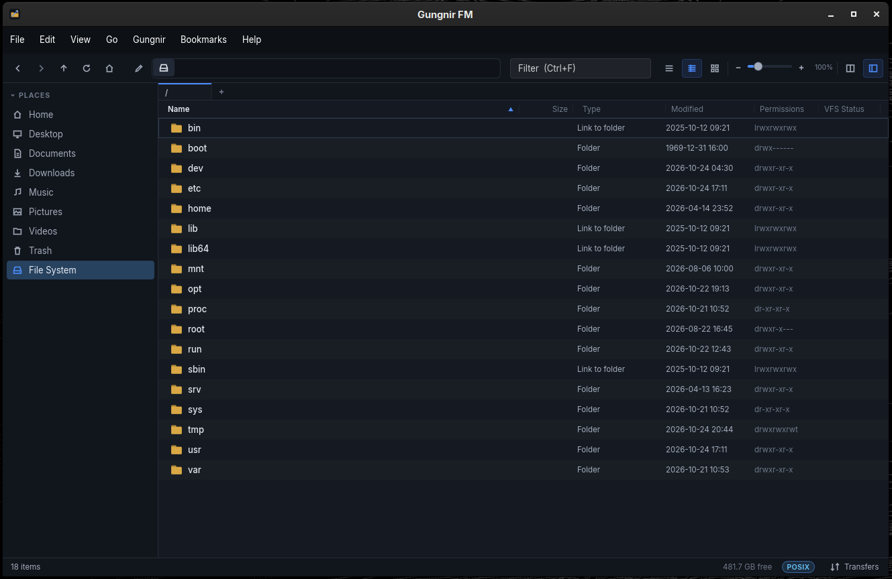
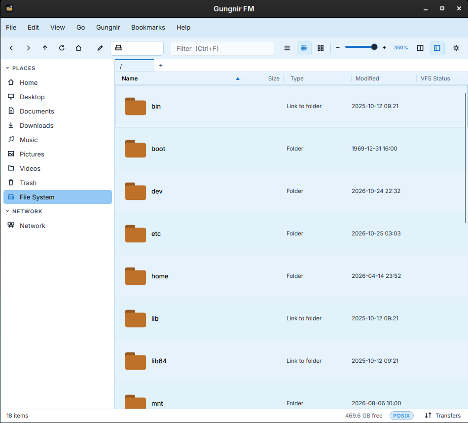

# Gungnir FM

A fast dual-pane Linux file manager written in Rust with [Slint](https://slint.dev).
It combines Nemo's layout and keyboard ergonomics with sub-millisecond responsiveness, adaptive dark and light themes with an interactive toolbar toggle, and an architecture where the UI thread never touches disk or blocking I/O. It serves as the companion GUI for [Gungnir VFS](https://gitlab.com/exalted6165/gungnir-vfs).

Source repository & issue tracker: [https://gitlab.com/exalted6165/gungnir-fm](https://gitlab.com/exalted6165/gungnir-fm).

| **Dark Mode (Original)** | **Light Mode** |
| :---: | :---: |
| [](docs/gungnir-fm.png) | [](docs/gungnir-fm-light.png) |

> **Seamless Theme Switching**: Switch between Dark Mode and Light Mode on the fly at any time:
> - **Interactive Toolbar Icon**: Click the celestial full moon / sun icon in the upper-right corner of the toolbar.
> - **Keyboard Shortcut**: Press `Ctrl+Shift+T`.
> - **Application Menu**: Select **View** → **Switch to Light Mode** (or **Switch to Dark Mode**).
> - **Persistent Session**: Your active theme is automatically preserved in `~/.config/gungnir-fm/session.json` and restored on next launch.

---

## ⚡ Quick Terminal Installation (Linux & BSD)

### Build Requirements
- **Operating Systems**: Linux (x86_64, AArch64, RISC-V), FreeBSD, OpenBSD, NetBSD, DragonFly BSD
- **Rust Toolchain**: Rust 1.92+ (edition 2024)
- **C/C++ Compiler**: C23 compiler (GCC 16+ or Clang 23+ targeting `-std=c23`)
- **System Libraries**: `libarchive` (`libarchive.so`), `libzstd`, `libzip`, `sqlite3`, `pkg-config`
- **Display & Windowing**: `fontconfig`, `libxkbcommon`, X11 (`libX11`) or Wayland (`libwayland-client`)
- **Optional Tools for Previews & Formats**: `7z` / `7zz`, `ffmpeg`, `imagemagick`, `flac`, `wavpack`, `libjxl`, `oxipng`

---

### 🐧 Linux Installation via Terminal

#### 1. Install Dependencies for Your Distribution

##### **Arch Linux / Manjaro / EndeavourOS**
```sh
sudo pacman -S --needed rust cargo git libarchive zstd libzip fontconfig libxkbcommon wayland libx11 sqlite pkgconf
```

##### **Debian / Ubuntu / Linux Mint / Pop!_OS**
```sh
sudo apt update
sudo apt install -y rustc cargo git libarchive-dev libzstd-dev libzip-dev libfontconfig1-dev libxkbcommon-dev libwayland-dev libx11-dev libsqlite3-dev pkg-config
```

##### **Fedora / RHEL / CentOS Stream**
```sh
sudo dnf install -y rust cargo git libarchive-devel libzstd-devel libzip-devel fontconfig-devel libxkbcommon-devel wayland-devel libX11-devel sqlite-devel pkgconf-pkg-config
```

##### **openSUSE (Tumbleweed / Leap)**
```sh
sudo zypper install -y rust cargo git libarchive-devel libzstd-devel libzip-devel fontconfig-devel libxkbcommon-devel wayland-devel libX11-devel sqlite3-devel pkgconf
```

##### **Alpine Linux**
```sh
sudo apk add rust cargo git libarchive-dev zstd-dev libzip-dev fontconfig-dev libxkbcommon-dev wayland-dev libx11-dev sqlite-dev pkgconf
```

##### **Void Linux**
```sh
sudo xbps-install -Sy rust cargo git libarchive-devel libzstd-devel libzip-devel fontconfig-devel libxkbcommon-devel wayland-devel libX11-devel sqlite-devel pkg-config
```

##### **Gentoo**
```sh
sudo emerge --ask dev-lang/rust dev-vcs/git app-arch/libarchive app-arch/zstd dev-libs/libzip media-libs/fontconfig x11-libs/libxkbcommon dev-libs/wayland x11-libs/libX11 dev-db/sqlite virtual/pkgconfig
```

##### **Nix / NixOS**
```sh
nix-shell -p rustc cargo git libarchive zstd libzip fontconfig libxkbcommon wayland xorg.libX11 sqlite pkg-config
```

#### 2. Clone and Install Locally (No Root Required)
```sh
git clone https://gitlab.com/exalted6165/gungnir-fm.git
cd gungnir-fm
./scripts/install-local.sh
```
This builds an optimized release binary and installs:
- Executable binary to `~/.local/bin/gungnir-fm`
- Gungnir VFS daemon to `~/.local/bin/gungnird`
- GIO VFS extension module to `~/.local/lib/gio/modules/libgiogungnir.so`
- Desktop entry to `~/.local/share/applications/gungnir-fm.desktop`
- Scalable SVG icon to `~/.local/share/icons/hicolor/scalable/apps/gungnir-fm.svg`

To uninstall:
```sh
./scripts/install-local.sh --uninstall
```

---

### 📦 Universal Linux Packages via Terminal

#### **Standalone AppImage (Zero-Install Single Binary)**
Download the self-contained portable AppImage containing both Gungnir FM and the Gungnir VFS daemon:
```sh
# 1. Download the latest AppImage
curl -fsSLO https://gitlab.com/exalted6165/gungnir-fm/-/releases/permalink/latest/downloads/Gungnir_FM-x86_64.AppImage

# 2. Make it executable
chmod +x Gungnir_FM-x86_64.AppImage

# 3. Run Gungnir FM
./Gungnir_FM-x86_64.AppImage

# Optional: Build the AppImage yourself from source
./packaging/appimage/build-appimage.sh
```

#### **Flatpak Package**
```sh
# Build and install locally for the current user
flatpak-builder --user --install --force-clean build packaging/flatpak/org.gungnir.GungnirFM.yml

# Run via Flatpak
flatpak run org.gungnir.GungnirFM
```

#### **Snap Package**
```sh
# Install from Snap Store with classic confinement for full mount management
sudo snap install gungnir-fm --classic

# Or build locally using snapcraft
snapcraft
sudo snap install --classic --dangerous gungnir-fm_*.snap
```

---

### 😈 BSD Installation via Terminal (FreeBSD, OpenBSD, NetBSD, DragonFly BSD)

Gungnir FM is fully compatible with BSD operating systems using standard POSIX and native BSD package managers.

#### **FreeBSD**
```sh
# 1. Install prerequisites via pkg
sudo pkg install -y rust cargo git libarchive zstd libzip fontconfig libxkbcommon sqlite3 pkgconf

# 2. Clone the repository
git clone https://gitlab.com/exalted6165/gungnir-fm.git
cd gungnir-fm

# 3. Build and install for current user
./scripts/install-local.sh

# 4. Launch Gungnir FM
~/.local/bin/gungnir-fm
```

#### **OpenBSD**
```sh
# 1. Install prerequisites via pkg_add
doas pkg_add rust git libarchive zstd libzip fontconfig xkbcommon sqlite3 pkgconf

# 2. Clone the repository
git clone https://gitlab.com/exalted6165/gungnir-fm.git
cd gungnir-fm

# 3. Build and install for current user
./scripts/install-local.sh

# 4. Launch Gungnir FM
~/.local/bin/gungnir-fm
```

#### **NetBSD**
```sh
# 1. Install prerequisites via pkgin
sudo pkgin install rust git libarchive zstd libzip fontconfig libxkbcommon sqlite3 pkg-config

# 2. Clone and build
git clone https://gitlab.com/exalted6165/gungnir-fm.git
cd gungnir-fm
./scripts/install-local.sh
```

#### **DragonFly BSD**
```sh
# 1. Install prerequisites via pkg
sudo pkg install -y rust cargo git libarchive zstd libzip fontconfig libxkbcommon sqlite3 pkgconf

# 2. Clone and build
git clone https://gitlab.com/exalted6165/gungnir-fm.git
cd gungnir-fm
./scripts/install-local.sh
```

---

### 💻 Running from Terminal and CLI Options

You can launch Gungnir FM directly from any terminal or script:

```sh
# Open Gungnir FM with the home directory in primary pane
gungnir-fm

# Open specific folders in dual-pane view
gungnir-fm ~/Documents ~/Downloads

# Open remote or virtual filesystem URIs
gungnir-fm gungnir://odin/asgard sftp://user@host/remote/path
```

#### Command-Line Arguments:
```
USAGE:
    gungnir-fm [OPTIONS] [LEFT_PATH] [RIGHT_PATH]

ARGUMENTS:
    [LEFT_PATH]     Initial path or URI for the primary (left) pane
    [RIGHT_PATH]    Initial path or URI for the secondary (right) pane

OPTIONS:
    -h, --help       Print help message
    -V, --version    Print version information
    -f, --foreground Run in foreground (default for process supervisors)
    -d, --daemon     Fork into background (daemonize for classic SysV/BSD)
    --pidfile PATH   Write process PID to file
    --ready-fd FD    Write ready notification byte to inherited file descriptor

DISPLAY BACKENDS:
    Natively supports Wayland (Hyprland, Sway, GNOME, KDE, River, Wayfire),
    X11 (X.Org, i3, dwm, bspwm, awesome, xmonad, openbox, fluxbox, cwm),
    and direct Linux Framebuffer / DRM/KMS (SLINT_BACKEND=linuxkms).

ENVIRONMENT VARIABLES:
    GUNGNIR_FM_BACKEND  Backend selection: auto, live, mock, off, live-or-off
    GUNGNIR_SOCKET      Custom gungnird UNIX socket path
    SLINT_BACKEND       Slint backend: winit, winit-software, linuxkms
    GUNGNIR_FM_TRACE=1  Log directory listing timings to stderr
```

---

### 📦 Packaging & Distribution Specifications

Gungnir FM provides first-class, standalone packaging configurations across Linux package ecosystems with **full Gungnir VFS integration** (`gungnird` daemon and `libgiogungnir.so` GIO extension module bundled into every package):

1. **Flatpak Package (`org.gungnir.GungnirFM`)**:
   - Manifest: `packaging/flatpak/org.gungnir.GungnirFM.yml`
   - Bundles `gungnird` and `libgiogungnir.so` in `/app/lib/gio/modules`.
   - Runtime wrapper starts the background daemon and wires `GIO_USE_VFS=gungnir` and `GUNGNIR_FM_BACKEND=live`.
   - Validate and build:
     ```sh
     packaging/flatpak/build-flatpak.sh
     ```

2. **Snap Package (`snapcraft.yaml`)**:
   - Manifest: `snap/snapcraft.yaml`
   - Base `core24`, classic confinement for full filesystem and mount management.
   - Bundles `gungnird` and `libgiogungnir.so`.
   - Validate and build:
     ```sh
     snap/build-snap.sh
     ```

3. **AppImage Package (`Gungnir_FM-x86_64.AppImage`)**:
   - Self-contained, portable single-file executable using standard Type 2 AppImage runtime.
   - Bundles `gungnird` and `libgiogungnir.so`, configures GIO dynamic VFS, and launches Gungnir FM with live backend.
   - Validate and build:
     ```sh
     packaging/appimage/build-appimage.sh
     ```

---

### 🔄 Integrated Automated Package Updater

Gungnir FM features an integrated package updater with a non-intrusive toolbar indicator:
- **Intelligent Update Detection**: Automatically checks for package updates via Freedesktop Update Portal (`org.freedesktop.portal.Updates`) in Flatpak, `snapd` in Snap, and release channels in AppImage/Native mode.
- **Top Toolbar "Update Available" Button**: The button appears dynamically in the top toolbar **strictly when a new package version is available**. If no update is available, the button is completely hidden.
- **One-Click Auto-Update**: Clicking "Update Available" triggers the package updater in the background without freezing the UI.
- **Automatic Disappearance**: Once the update is applied, the button and status message disappear automatically until the next version release.

---

### 🔒 Privacy & Data Hygiene Guarantee

Gungnir FM strictly adheres to zero-personal-data policies:
- No personal usernames, emails, tokens, IP addresses, or private file paths are ever embedded in source files, packaging manifests, AppImage payloads, or build artifacts.
- All paths utilize standard XDG variables (`$XDG_RUNTIME_DIR`, `$XDG_CONFIG_HOME`, `$XDG_DATA_DIRS`) and POSIX standards.

---

## Key Features

### 🗂️ Panes, Tabs & Navigation
- **Dual-Pane Layout (`F3`)**: Single-pane default with instantaneous split-pane toggling.
- **Notebook Tabs per Pane (`Ctrl+T` / `Ctrl+W`)**: Independent multi-tab strips for primary and secondary panes, each maintaining its own path, navigation history stack (back/forward buffers), scroll position, and display titles.
- **Hybrid Path Bar**: Interactive breadcrumbs with Nemo-style home routing and remote badges, or direct editable path entry (`Ctrl+L`) for POSIX paths, `gungnir://`, `sftp://`, and `smb://` URIs.
- **Virtualized Views**: Compact list, detailed list, and thumbnail grid views virtualized with Slint `ListView`. 100,000-entry folders scroll smoothly without UI stutters.
- **Sortable Columns**: Natural, folders-first ordering by name, size, type, modified time, POSIX permissions, and Gungnir VFS sync status.

### 🖼️ Visual Image & Video Previews
- **Master Encyclopedia Media Support**:
  - **Universal & Web Raster**: JPEG (JFIF/EXIF), PNG, GIF, BMP/DIB, TIFF/BigTIFF, WebP, ICO, CUR, ICNS.
  - **High-Efficiency & Modern Encodings**: AVIF, AVIS, HEIC/HEIF, HEIFS, JPEG XL (`.jxl`), JPEG 2000 (`.jp2`, `.j2k`, `.jpx`), JPEG XR (`.jxr`), JPEG XS, FLIF, FUIF, BPG, QOI, Farbfeld.
  - **Vector & Procedural Graphics**: SVG, SVGZ, EPS, PS, AI, CDR, WMF, EMF, CGM, DXF, DWG, Gerber (`.gbr`), XAR, SK1, Flash (`.swf`, `.fla`).
  - **RAW Camera Sensors**: DNG, Canon CRW/CR2/CR3, Nikon NEF/NRW, Sony ARW/SRF/SR2, Fujifilm RAF, Olympus/OM ORF/OM, Panasonic RW2, Pentax PEF, Kodak KDC/DCR/DCS, Leaf/Mamiya MOS/MEF, Hasselblad 3FR/FFF, Phase One IIQ/CAP, Sigma X3F, Leica RWL, Samsung SRW, GoPro GPR, Minolta MRW.
  - **Professional HDR, VFX & 3D Textures**: OpenEXR (`.exr`), Radiance HDR (`.hdr`, `.pic`), DPX, Cineon (`.cin`), DirectDraw Surface (`.dds`), Khronos KTX/KTX2, ASTC, PowerVR PVR/PVRTC, PKM, Valve VTF, TGA/TARGA, Adobe PSD/PSB, GIMP XCF, Corel CPT, Affinity AFPHOTO, Paint.NET PDN, Krita KRA, OpenRaster ORA, Amiga IFF/ILBM, SGI RGB/BW.
  - **Scientific, Medical & Geospatial**: FITS, DICOM (`.dcm`), GeoTIFF, NITF, MrSID, ECW, HDF5/NetCDF (`.h5`, `.nc`), Aperio SVS, Hamamatsu NDPI, OME-TIFF, Gatan DM3/DM4, MRC, NIfTI (`.nii`), VTK.
  - **Legacy, Retro & Specialized Bitmaps**: PCX, Netpbm (`.pbm`, `.pgm`, `.ppm`, `.pam`, `.pnm`), XBM, XPM, XWD, Sun Raster, MacPaint, GEM IMG, WBMP, QuickDraw PICT, Dr. Halo CUT, BLP, PlayStation TIM/TIM2, PSP GXT.
  - **Video Containers & Cinema Mezzanine**: MP4, MKV, WebM, QuickTime MOV, AVI, WMV/ASF, FLV/F4V, OGV, 3GP/3G2, DivX/Xvid, MPEG Transport Stream (`.m2ts`, `.mts`), MPEG Program Stream (`.mpg`, `.vob`), HD-DVD EVO, MXF, GXF, DVR-MS, WTV, MOD/TOD, Apple ProRes, Avid DNxHD/DNxHR, Blackmagic RAW (`.braw`), REDCODE RAW (`.r3d`), ARRIRAW (`.ari`), Canon CRM, XAVC, DVCPRO, HDV, DV, RealMedia RM/RMVB, Bink BIK/BIK2, Smacker SMK, RoQ, AMV/MTV, IVF, Y4M, raw YUV.
  - **2026+ Active Specs**: AV2 (AOMedia Video 2), JPEG AI, 3D Gaussian Splatting (`.splat`, `.spz`), PLY point clouds.
- **Top Toolbar Zoom Slider**: Interactive zoom slider located directly in the top toolbar alongside view modes. Features stepping buttons (`[-]` / `[+]`), interactive track drag, and a percentage pill with click-to-reset.
- **Large-Scale Preview Scaling**: Smoothly scales previews from 50% to 350% (enlarging cards up to 840px in grid view and 80px in list view) with 512×512 thumbnail generation.
- **Decoupled Text Typography**: Text label font sizes remain locked to crisp 11–13px system typography while thumbnail preview cards enlarge prominently.
- **Disk Caching**: Asynchronous background generation cached under `~/.cache/gungnir-fm/thumbnails/` using source URI and modification timestamp keys.

### 📚 Master Encyclopedia: Universal Non-Image & Non-Video Format Engine
Gungnir FM provides native format detection, authoritative human-readable classification, Freedesktop MIME resolution, and Spacebar Quick Preview inspection across all 10 core technical domains:
- **Part 1: Audio Formats, Codecs & Sound Containers**:
  - *Lossless*: FLAC, ALAC, WAV, AIFF/AIF/AIFC, APE (Monkey's Audio), WavPack (`.wv`), TTA, Shorten (`.shn`), TAK, OptimFROG (`.ofr`, `.ofs`), DSD/DSF/DFF, DXD, MLP, WMA Lossless, BWF, RF64, Apple CAF, Sun/NeXT AU/SND, Wave64.
  - *Lossy*: MP3, AAC, Opus, Ogg Vorbis, AC-3, E-AC-3, Dolby TrueHD, DTS, DTS-HD MA, DTS:X, WMA, Sony ATRAC (`.oma`, `.omg`), Musepack (`.mpc`), Speex, AMR/AMR-WB, GSM 06.10, G.711/G.722/G.726/G.729, iLBC, SILK, QDMC, VSELP.
  - *Trackers & Chiptunes*: MIDI (`.mid`, `.midi`, `.smf`, `.rmi`, `.kar`), Soundtracker/ProTracker MOD, FastTracker 2 XM, Scream Tracker S3M, Impulse Tracker IT, MultiTracker MTM, Unreal UMX, Composer 669, Farandole FAR, Oktalyzer OKT, Commodore 64 SID, NES NSF/NSFE, SNES SPC700, VGM/VGZ, Genesis GYM, PC Engine HES, Game Boy GBS, MSX KSS, ZX Spectrum AY, Atari SAP.
  - *DAW Sessions & Soundfonts*: Ableton ALS, Cubase CPR, FL Studio FLP, REAPER RPP, Pro Tools PTX/PTF, Studio One SONG, Logic Pro LOGICX, Reason REASON, Sonar CWB, Audition SESX, SoundFont SF2/SF3, SFZ, Kontakt NKI, GigaStudio GIG.
- **Part 2: Documents, Office, Text, Layout & Typography**:
  - *Text & Markup*: TXT, Markdown (`.md`), AsciiDoc (`.adoc`), Emacs Org-mode (`.org`), reStructuredText (`.rst`), TeX/LaTeX (`.tex`), RTF, NFO, FILE_ID.DIZ, LOG, Perl POD.
  - *Paginated & Publishing*: PDF, PDF/A, PDF/X, PDF/E, PostScript (`.ps`), XPS, OpenXPS, DjVu (`.djvu`, `.djv`), EPUB, Mobipocket MOBI, Amazon Kindle AZW/AZW3/KF8, FictionBook FB2, Comic Book Archives (CBR, CBZ, CB7, CBT), Compiled HTML Help CHM, Microsoft Reader LIT, DVI.
  - *Spreadsheets*: Excel (XLSX, XLS, XLSM, XLSB, XLTX, XLTM), OpenDocument ODS/OTS, Apple Numbers, CSV, TSV/TAB, DIF, SYLK, Lotus 1-2-3 (WK1/WK3/WK4), Quattro Pro (QPW/WB1/WB2).
  - *Word Processing & Presentations*: Word (DOCX, DOC, DOCM, DOT, DOTX), OpenDocument ODT/OTT, Apple Pages, WordPerfect WPD, AbiWord ABW, PowerPoint (PPTX, PPT, PPTM, PPS, PPSX), OpenDocument ODP/OTP, Apple Keynote, OpenOffice SXI.
  - *Typography*: TrueType (TTF, TTC), OpenType (OTF, OTC), WOFF, WOFF2, EOT, dfont, PostScript Type 1 PFB, PFM, AFM, X11 BDF/PCF, SFNT, Windows FNT/FON, BMF.
- **Part 3: 3D Models, CAD, CAM, BIM & Spatial Data**:
  - *Realtime 3D & Interchange*: GLTF, Binary GLB, Pixar USD/USDA/USDC, USDZ, OBJ, MTL, FBX, COLLADA DAE, 3DS, Blender BLEND, Cinema 4D C4D, 3ds Max MAX, Maya MA/MB, LightWave LWO/LWS, Modo LXO, DirectX X, Source Engine SMD/DMX, Quake MD2/MD3/MD5.
  - *CAD, CAM & Solid Modeling*: STEP (`.step`, `.stp`), IGES (`.iges`, `.igs`), STL, 3MF, AMF, ACIS SAT/SAB, Parasolid X_T/X_B, Jupiter Tessellation JT, SolidWorks SLDPRT/SLDASM, CATIA CATPART/CATPRODUCT, Inventor IPT/IAM, Creo PRT/ASM, FreeCAD FCSTD, OpenSCAD SCAD, CNC G-code (`.gcode`, `.nc`).
  - *BIM & Architecture*: IFC (ISO 16739), Revit RVT/RFA, Navisworks NWD/NWC/NWF, ArchiCAD PLN, BIM Collaboration Format BCF.
  - *Point Clouds & Volumetrics*: PLY, Point Cloud Library PCD, ASPRS LAS, Lossless LASzip LAZ, ASTM E57, XYZ/PTS, OpenVDB (`.vdb`), Gaussian Splatting (`.splat`, `.spz`).
- **Part 4: Archives, Compression, Packages & Virtual Disks**:
  - *Archives*: ZIP/ZIPX, TAR, GZ, BZ2, XZ, Zstandard (`.zst`, `.zstd`), 7Z, RAR, CAB, ARJ, LHA/LZH, ALZ/EGG, Unix Z, LZ4, Brotli BR, CPIO, Unix AR, WinACE ACE, PAK, Doom WAD, SQX, ZOO, SEA ARC.
  - *Disk Images & ROMs*: Optical ISO, Raw IMG, Apple DMG, Microsoft VHD/VHDX, VMware VMDK, VirtualBox VDI, QEMU QCOW/QCOW2, CUE, Alcohol MDF/MDS, Nero NRG, DiscJuggler CDI, Floppy DSK, Amiga ADF, Nintendo ROMs (NDS, GBA, NES, SFC/SMC, Z64/N64), MAME CHD, PSP CSO, Wii WBFS.
  - *Packages*: DEB, RPM, Android APK/AAB, iOS IPA, Windows MSI/MSIX/APPX, macOS PKG, Flatpak (`.flatpak`, `.flatpakref`), AppImage, Ubuntu Snap, Gentoo ebuild.
- **Part 5: Executables, Compiled Objects, Binaries & Runtimes**:
  - *Native Binaries*: Linux/BSD ELF, Windows PE (`.exe`, `.dll`, `.sys`), Mach-O, COFF, a.out, DOS COM, compiled object files (`.o`), Shared Objects (`.so`), macOS dylib, static archives (`.a`, `.lib`).
  - *Bytecode & Shaders*: WebAssembly WASM/WAT, Java CLASS/JAR/WAR/EAR, Python PYC/PYO, Android Dalvik DEX/ODEX/VDEX, Erlang BEAM, Lua LUAC, .NET CIL/MSIL, SPIR-V SPV, DirectX DXBC/DXIL, SourcePawn SMX, Flash ABC.
- **Part 6: Data Serialization, Configuration & Protocols**:
  - *Structured Configs*: JSON, JSONC, JSON5, JSON-LD, YAML, TOML, XML, INI, Java properties, CONF/CFG, shell ENV, Apple PLIST, HashiCorp HCL, KDL, Rusty Object Notation RON.
  - *Binary Serialization*: Protocol Buffers (`.proto`, `.pb`), FlatBuffers FBS, MessagePack, BSON, Apache Avro, CBOR, ASN.1, Apache Thrift, Cap'n Proto, Jackson Smile, Amazon Ion.
  - *Web & APIs*: HTML, XHTML, CSS, SCSS/SASS, LESS, JavaScript (JS, MJS, CJS), TypeScript (TS, MTS, CTS), React JSX/TSX, GraphQL (`.graphql`, `.gql`), WSDL, RSS, Atom.
- **Part 7: Databases, Big Data, Storage Engines & GIS**:
  - *Relational & Embedded*: SQL dumps, SQLite (`.sqlite`, `.sqlite3`, `.db`), WAL/SHM, Access MDB/ACCDB, dBase DBF, SQL Server MDF/LDF, MySQL InnoDB IBD/FRM, Firebird FDB, InterBase GDB, raw DAT.
  - *Columnar & Scientific*: Apache Parquet, Apache ORC, Arrow Feather, Arrow IPC, HDF5, NetCDF, Zarr, CERN ROOT, Stata DTA, SPSS SAV/POR, R RDATA/RDS, NumPy NPY/NPZ.
  - *GIS Spatial*: GeoJSON, KML/KMZ, ESRI Shapefiles (`.shp`, `.shx`), GPX, OGC GeoPackage GPKG, GML, OpenStreetMap OSM/PBF, DEM elevation rasters.
- **Part 8: Machine Learning, AI Weights & Computational Tensors**:
  - *Weights & Checkpoints*: Safetensors, GGUF, GGML, ONNX, PyTorch PT/PTH, training CKPT, TensorFlow Lite TFLITE, Keras H5/KERAS, Apple Core ML MLMODEL/MLPACKAGE, TensorRT ENGINE/PLAN, MyriadX BLOB.
  - *Vector Search & Embeddings*: Lance columnar data (`.lance`), FAISS index, Spotify Annoy, USearch, HNSW graphs, WebDataset training shards.
- **Part 9: Cryptography, Security, Identity & Telemetry**:
  - *PKI & Vaults*: PEM, DER, X.509 CRT/CER, private keys (`.key`), PKCS #12 P12/PFX, Java KeyStore JKS/BKS, CSR, CRL, SSH/PGP PUB, PGP/GPG ASC/GPG, age encryption, KeePass KDBX.
  - *Observability & Forensics*: libpcap PCAP, PCAPNG, CAP, HTTP Archive HAR, Windows Event Log EVTX, Syslog streams, Windows ETL, Google pprof, OpenTelemetry OTLP.
- **Part 10: 2026 Active Standards & Future Formats**:
  - *Post-Quantum Cryptography*: FIPS 203 ML-KEM key containers (`.mlkem`, `.kem`), FIPS 204 ML-DSA and FIPS 205 SLH-DSA signature/key blobs (`.mldsa`, `.slhdsa`).
  - *Advanced AI & Runtimes*: GGUF v3/v4 MoE/FP4/MXFP8 containers, Safetensors 2.0 streaming sharded formats, LanceDB v2 columnar engine, WebAssembly Interface Types (`.wit`), C2PA provenance manifest assertions (`.c2pa`).

### 🧬 Supplementary Master Compilation (Parts 1–14 Native Coverage)
- **Part 1: Subtitles, Timed Text, Closed Captions & Lyrics**: SRT, WebVTT (`.vtt`, `.webvtt`), ASS, SSA, MicroDVD/SubViewer SUB, VobSub IDX, SAMI (`.smi`, `.sami`), TTML/DFXP, Scenarist SCC, MacCaption MCC, Cheetah CAP, EBU-STL, Universal Subtitle Format USF, YouTube SBV, LRC synchronized karaoke, Screen Electronics PAC.
- **Part 2: Bioinformatics, Genomics, Proteomics & Structural Biology**: FASTA (`.fasta`, `.fas`, `.fa`, `.fna`, `.faa`), FASTQ (`.fastq`, `.fq`), SAM, BGZF BAM, CRAM, Variant Call Format VCF / vCard, Binary VCF BCF, GFF/GFF3, GTF, BED, WIG, BigWig, BigBed (`.bb`), Protein Data Bank PDB, mmCIF/PDBx/CIF, GenBank (`.gb`, `.gbk`), EMBL, Sanger AB1/ABI, Roche 454 SFF, AnnData H5AD, Mascot Generic MGF, Proteomics mzML.
- **Part 3: Electronic Design Automation (EDA), Semiconductors & PCB Fabrication**: GDSII (`.gds`, `.gdsii`, `.gds2`), OASIS, Library Exchange Format LEF, Design Exchange Format DEF, EDIF netlists, SPICE/CIR circuits, Synopsys SDC, Standard Delay SDF, EAGLE/Allegro BRD, Schematic SCH, KiCad (`.kicad_pcb`, `.kicad_sch`, `.kicad_mod`), IPC-2581, ODB++/ODB, Excellon NC Drill DRL/TAP, HPGL/PLT.
- **Part 4: Mathematical Modeling, Symbolic Computation & Notebooks**: Jupyter Notebook IPYNB, MATLAB MAT / script M, Wolfram Mathematica NB / Wolfram Language WL/WLS, Maple MW/MWS, SMath SM/SMATH, Mathematical Programming System MPS, LP, AMPL, GAMS GMS, NASA CDF, SBML biology models, CellML.
- **Part 5: Meteorology, Earth Observation, Oceanography & Remote Sensing**: WMO GRIB1/GRIB2 (`.grib`, `.grib1`, `.grib2`, `.grb`, `.grb2`), WMO BUFR, NASA HDF-EOS, RINEX GNSS observables, NMEA-0183 telemetry, PMTiles, MBTiles, Cloud Optimized GeoTIFF COG, WKT, WKB, SDTS, ESRI E00 coverage, raw multi-band BIL/BSQ.
- **Part 6: Digital Forensics, Incident Response & Memory Dumps**: EnCase Expert Witness E01/L01, Advanced Forensic Format AFF/AFF4, raw dd bitstream, Windows memory dump DMP/MDMP, VMware VMEM snapshots, raw physical MEM, Volatility symbol tables VSL, Windows Registry REGF, Prefetch PF, Extensible Storage Engine EDB.
- **Part 7: Personal Information, Contacts, Calendaring & Financial**: Electronic business cards vCard VCF, iCalendar ICS/ICAL/VCS, Unix MBOX, RFC 822 EML/EMLX, Outlook MSG/PST/OST, Outlook Express DBX, LDAP LDIF, Open Financial Exchange OFX/QFX, Quicken QIF, ISO 20022 CAMT XML, SWIFT MT940/MT942, BAI2 cash management, XBRL/iXBRL financial statements, FIX financial messaging.
- **Part 8: Motion Capture, Biomechanics & Skeletal Rigging**: Biovision Hierarchy BVH, C3D biomechanics coordinates, Acclaim AMC, Motion Analysis TRC, Character Studio CSM / Biped BIP, Hierarchical Translation-Rotation HTR, Xsens MVN/MVNX.
- **Part 9: Game Engine Asset Archives, Level Geometry & Packages**: Valve BSP level geometry, Valve Pak VPK, Quake/id Tech PK3/PK4, Bethesda BSA/BA2, Blizzard MPQ, EA BIG/VIV, Godot PCK, Unity ASSETS/UNITY3D, Half-Life WAD2/WAD3, Steam GCF, Frostbite CAS, NetEase NPK, CRI Middleware CPK, Build Engine GRP.
- **Part 10: Firmware, PLD/FPGA Bitstreams & Hardware Emulation**: Intel HEX records, Motorola S-Record SREC/S19/S28/S37, Xilinx BIT bitstreams, Altera/Intel FPGA RBF, SOF, POF, JEDEC JED, USB DFU payloads, ROM patches (IPS, UPS, BPS), game cart/package dumps (XCI, NSP, CIA).
- **Part 11: Accessibility, Braille & Tactile Graphics**: Braille Ready Format BRF, Braille plain stream BRL, DAISY digital talking books (`.daisy`, `.dtb`), Braille Dot eXchange BDX.
- **Part 12: Source Code, Hardware Description & Domain Languages**: C/C++, Rust, Go, Python, Ruby, PHP, C#, Visual Basic, F#, Java, Kotlin, Swift, Scala, Clojure, Haskell, OCaml, Elm, Elixir, Erlang, Common Lisp, Scheme, R, Julia, Lua, Perl, Shell scripts (Bash, Zsh, Fish, Ksh), AWK, SED, Tcl, Assembly (`.asm`, `.s`), Fortran, COBOL, Ada, Pascal, D, Nim, Zig, V, Odin, Dart, Verilog HDL, SystemVerilog, VHDL hardware descriptions.
- **Part 13: Build Manifests, Declarative Specs & Infrastructure-as-Code**: Makefile (`Makefile`, `.mk`), CMake, Nix derivations, GNU Guix packages, Bazel build rules, Buck build rules, Terraform HCL (`.tf`, `.tfvars`), Cargo/NPM lockfiles.
- **Part 14: Retro, Synthesizer & Legacy System Audio**: Creative Voice VOC, Amiga 8SVX, AdLib Visual Composer ROL, Creative CMF FM synth, id Software IMF (OPL2), Doom/Heretic MUS, HMI/HMP MIDI, Miles Sound System XMI, Reality Adlib Tracker RAD, HSC-Tracker FM, SNG, DiamondWare Digitized DWD, Korg Trinity/Triton multisample KMP/KSF.

### 🔬 Supplementary Master Compilation: Specialized, Industrial & Scientific Formats (Parts 1–14)
- **Part 1: Industrial Automation, Robotics, PLCs & SCADA**: PLCopen XML (`.plcopen`), Rockwell Automation Studio 5000 Logix (`.l5x`, `.acd`), Siemens SIMATIC Step 7 & Micro/WIN (`.s7p`, `.s7s`, `.mwp`), Siemens TIA Portal archives (`.tia`, `.ap14`–`.ap19`), CoDeSys PLC (`.pro`, `.project`), Unified Robot Description Format URDF (`.urdf`), ROS Xacro (`.xacro`), Simulation Description Format (`.sdf`), ROS 1 bag (`.bag`), Foxglove/ROS 2 MCAP (`.mcap`), OPC UA NodeSet XML (`.nodeset`, `.nodeset2`), MTConnect telemetry XML, PROFIBUS/PROFINET GSD/GSDML (`.gsd`, `.gsdml`), CANopen/DeviceNet EDS (`.eds`), CANopen XDD (`.xdd`).
- **Part 2: Chemistry, Molecular Modeling & Materials Science**: MDL Molfile (`.mol`), MDL Structure-Data File (`.sdf`), SMILES chemical notation (`.smi`, `.smiles`), Chemical Markup Language (`.cml`), IUPAC Chemical Identifier InChI/InChIKey (`.inchi`, `.inchikey`), ChemDraw (`.cdx`, `.cdxml`), Crystallographic Information File CIF (`.cif`), AutoDock PDBQT (`.pdbqt`), GROMACS coordinates/topologies/trajectories (`.gro`, `.top`, `.itp`, `.trr`, `.xtc`), CHARMM/NAMD DCD (`.dcd`), AMBER CRD/INP/PRMTOP/PBRTOP, Gaussian/ORCA/Q-Chem output logs (`.out`), NWChem inputs (`.nw`), VASP density functional theory inputs (`POSCAR`, `POTCAR`, `INCAR`, `KPOINTS`), Gaussian wavefunction checkpoints (`.chk`).
- **Part 3: Astronomy, Astrophysics & Deep Space Missions**: Advanced Scientific Data Format ASDF (`.asdf`), IVOA Virtual Observatory Tabular Format VOTable (`.votable`, `.vot`), NASA JPL NAIF SPICE Kernels: Ephemeris SPK (`.spk`), Planetary Constants PCK (`.pck`), Instrument IK (`.ik`), C-Matrix CK (`.ck`), Frame FK (`.fk`), Spacecraft Clock SCLK (`.sclk`, `.tsc`), Leapseconds LSK (`.lsk`, `.tls`), FITS-WCS headers, Astropy Enhanced CSV (`.ecsv`).
- **Part 4: Geophysics, Seismology & Petroleum Exploration**: SEG-Y seismic reflection (`.segy`, `.sgy`), SEG-D seismic field acquisition (`.segd`, `.sgd`), CWLS Log ASCII Standard well logging LAS (`.las`), Digital Log Interchange Standard DLIS (`.dlis`), Schlumberger LIS (`.lis`), Energistics RESQML (`.resqml`), WITSML drilling XML (`.witsml`), PRODML hydrocarbon production XML (`.prodml`), IRIS SEED seismology (`.seed`), MiniSEED time-series (`.mseed`, `.miniseed`), Seismic Analysis Code SAC (`.sac`), NIED WIN/WIN32 waveform data (`.win`, `.win32`).
- **Part 5: RF Telecom, Software-Defined Radio (SDR) & Telephony**: Signal Metadata Format SigMF (`.sigmf`, `.sigmf-data`, `.sigmf-meta`), Raw I/Q baseband samples (`.ciq`, `.iq`), Touchstone RF S-parameters (`.s1p`–`.s4p`, `.snp`), GNU Radio 32-bit float complex I/Q (`.cfile`), VITA 49 Radio Transport VRT (`.vrt`, `.v49`), Telecom Call Detail Records CDR (`.cdr`), SS7 protocol captures (`.ss7`), GTP mobile core captures (`.gtp`), Diameter AAA captures (`.diameter`).
- **Part 6: Cybersecurity, Threat Intel, SBOM & Vulnerability Management**: OASIS STIX threat intelligence JSON (`.stix`, `.stix2`), TAXII messages (`.taxii`), OASIS SARIF static analysis reports (`.sarif`), ISO/IEC 5962 SPDX SBOM (`.spdx`), OWASP CycloneDX SBOM (`.cyclonedx`), CSAF security advisories (`.csaf`), CVRF vulnerability advisories (`.cvrf`), YARA malware detection rules (`.yara`, `.yar`), Sigma SIEM log detection rules (`.sigma`), Snort/Suricata IDS network rules (`.rules`), MISP threat intel (`.misp`), KAPE forensic triage targets (`.kape`, `.tkape`, `.gkape`).
- **Part 7: Aviation, Maritime Navigation & Transit Data**: ARINC 424 navigation databases (`.a424`, `.arinc424`, `.arinc`), Aeronautical Information Exchange Model AIXM (`.aixm`), Flight Information Exchange Model FIXM (`.fixm`), Weather Information Exchange Model WXXM (`.wxxm`), IHO S-57 nautical charts (`.000`, `.s57`), IHO S-63 encrypted charts (`.s63`), IHO S-100 hydrographic framework (`.s100`), IHO S-101 ENCs (`.s101`), AIS marine vessel telemetry (`.ais`), GTFS transit feeds (`.gtfs`), GTFS-RT Realtime Protocol Buffers (`.gtfsrt`).
- **Part 8: Color Management, Prepress & Printer Protocols**: ICC/ICM color profiles (`.icc`, `.icm`), PostScript Printer Description PPD (`.ppd`), CIP4 Job Definition Format JDF (`.jdf`), CIP4 Job Messaging Format JMF (`.jmf`), IBM Advanced Function Presentation AFP/AFPDS (`.afp`, `.afpds`), HP Printer Command Language PCL/PCL-XL (`.pcl`, `.pclx`, `.pxl`), Epson ESC/P printer streams (`.escp`, `.epson`), Windows Print Spooler SPL/SHD (`.spl`, `.shd`), CUPS device-ready print rasters (`.cups`).
- **Part 9: Low-Level Hardware, Embedded Device Trees & BIOS/UEFI**: UEFI BIOS Capsule Updates (`.cap`), Flash Descriptor / Intel ME SPI flash images (`.fd`), Intel ME/TXE firmware (`.me`, `.txe`), Compiled Device Tree Blobs DTB/DTBO (`.dtb`, `.dtbo`), Device Tree Sources DTS/DTSI (`.dts`, `.dtsi`), ACPI DSDT/SSDT System Description Tables (`.dsdt`, `.ssdt`), ACPI Machine Language AML bytecode (`.aml`), ACPI Source Language ASL/DSL (`.dsl`, `.asl`), PCI Option ROMs (`.orom`), Intel Platform Data Region PDR (`.pdr`).
- **Part 10: Compiler Internals, Debug Symbols & Profiling Runtimes**: DWARF debugging information (`.dwarf`), Microsoft Program Database PDB (`.pdb`), LLVM Bitcode (`.bc`), LLVM Assembly IR (`.ll`), GCC GIMPLE intermediate representation (`.gimple`), Linux perf event databases (`perf.data`, `.perf`), Chromium/Catapult traces (`.trace`), Speedscope flamegraph profiles (`.speedscope`), Java JVM heap dumps HPROF (`.hprof`), POSIX crash core dumps (`core`, `.core`).
- **Part 11: Key-Value Stores, NoSQL Internals & Log-Structured Engines**: LSM-Tree Sorted String Tables SSTable (`.sst`, `.sstable`), RocksDB/LevelDB version manifests (`manifest`), Redis Database snapshots RDB (`.rdb`), Redis transaction append-only logs AOF (`.aof`), PostgreSQL custom-format dump archives (`.pgdump`, `.dump`), ClickHouse columnar primary key mark indexes (`.mrk`, `.mrk2`, `.mrk3`).
- **Part 12: Spatial Audio, Haptics & Acoustic Impulses**: ITU-R Audio Definition Model ADM spatial audio (`.adm`), SOFA HRTF spatial acoustics datasets (`.sofa`), Apple Haptic Audio Patterns AHAP (`.ahap`), Super Impulse Response SIR reverberation waves (`.sir`), Audio Design Vault ADV DSP profiles (`.adv`).
- **Part 13: Web Archiving, E-Discovery, Legal Tech & Bibliographic Data**: ISO 28500 WARC web archives (`.warc`), WACZ web archive packages (`.wacz`), EDRM e-discovery XML load files (`.edrm`), Opticon/Concordance image delimiters (`.opt`), MARC21 machine-readable bibliographic records (`.mrc`, `.marc`, `.marc21`), BibTeX LaTeX reference databases (`.bib`, `.bibtex`), RIS bibliographic citation tags (`.ris`), EndNote exports (`.enw`), Library of Congress METS metadata schemas (`.mets`), PREMIS digital preservation XML (`.premis`).
- **Part 14: Distributed Ledgers, Smart Contracts & Block Data**: Bitcoin Core raw blockchain blocks (`.blk`), Bitcoin Core blockchain undo data (`.rev`), Solidity smart contracts (`.sol`), Vyper smart contracts (`.vy`), EVM smart contract ABI interfaces (`.abi`), IPFS/IPLD Content Addressable Archives CAR (`.car`).

### 🖥️ Universal Display Server & Window Manager Compatibility
Gungnir FM runs natively without crashes, panics, or missing window mappings across 48 Linux and UNIX display targets:
- **Display Servers & Protocols**: Wayland, XLibre, X.Org Server, XFree86, Phoenix X Server, Arcan, Mir (legacy standalone), Y Window System, TinyX / KDrive, XWayland, Xephyr, Xvfb (Virtual Framebuffer), Xvnc / TigerVNC, nxagent (X2Go / NX), Xdummy, DirectFB / Linux Framebuffer (`/dev/fb*` & direct DRM/KMS `/dev/dri/card*`), kmscon, Twin.
- **Tiling & Dynamic Window Managers**: i3wm, dwm, bspwm, AwesomeWM, xmonad, Qtile (X11 backend), LeftWM, Herbstluftwm, Spectrwm, Ratpoison, StumpWM, cwm (Calm Window Manager). Window min-size is relaxed to 480×320 for split-column tiling without clipping.
- **Floating, Stacking & Desktop Environments**: Openbox, Fluxbox, Blackbox, IceWM, JWM, Window Maker, AfterStep, FVWM, PekWM, twm, mwm, KWin (KDE Plasma), Mutter (GNOME), Compiz, Metacity, Xfwm4 (Xfce), Marco (MATE), Enlightenment (E16 / E26 X11 engine).
- **ICCCM & EWMH Compliance**: Automatic `RESOURCE_NAME` and `XCLIENT_NAME` setup guarantees standardized `WM_CLASS = "gungnir-fm"` and `_NET_WM_ICON` across all WMs.
- **Automated Software Rendering Fallback**: On headless or virtual X servers lacking hardware GLX (e.g. Xvfb, Xdummy, TinyX, nxagent), Gungnir FM catches initialization errors and automatically switches to `SLINT_BACKEND=winit-software`.

### ⚙️ Native Cross-Init System & Supervisor Specification
Gungnir FM is built to run natively across all 24 Linux and BSD init systems and process supervisors without requiring or assuming `systemd` or `libsystemd`:
1. **systemd** (`init/systemd/gungnir-fm.service`)
2. **OpenRC** (`init/openrc/gungnir-fm`)
3. **runit** (`init/runit/gungnir-fm/run`)
4. **s6 & s6-rc** (`init/s6/gungnir-fm/`)
5. **dinit** (`init/dinit/gungnir-fm`)
6. **SysVinit / inittab** (`init/sysvinit/gungnir-fm`)
7. **BSD Init / rc.subr** (`init/bsd/gungnir_fm`)
8. **GNU Shepherd** (`init/shepherd/gungnir-fm.scm`)
9. **BusyBox init** (`init/busybox/rc.gungnir-fm`)
10. **Toybox init** (`init/busybox/rc.gungnir-fm`)
11. **Finit** (`init/finit/gungnir-fm.conf`)
12. **procd (OpenWrt)** (`init/procd/gungnir-fm.init`)
13. **sinit (suckless init)**
14. **nosh** (`init/daemontools/gungnir-fm/run`)
15. **daemontools** (`init/daemontools/gungnir-fm/run`)
16. **daemontools-encore** (`init/daemontools/gungnir-fm/run`)
17. **perp** (`init/daemontools/gungnir-fm/run`)
18. **anopa** (`init/s6/gungnir-fm/`)
19. **cinit**
20. **initng**
21. **Upstart** (`init/upstart/gungnir-fm.conf`)
22. **OpenLaunchD** (`init/launchd/org.gungnir.fm.plist`)
23. **Epoch**
24. **minit** & **simpleinit-msb**

- **Foreground by Default**: Complies with modern process supervisors; writes stream logs to stdout/stderr.
- **Agnostic Readiness Notification**: Built-in support for pipe file descriptors (`--ready-fd <FD>` or `$S6_NOTIFICATION_FD`) and raw datagram sockets (`$NOTIFY_SOCKET`) without linking against `libsystemd`.
- **Legacy Daemonization**: Clean `-d / --daemon` and `--pidfile <PATH>` options for traditional SysVinit and BSD `rc.subr` scripts.
- **POSIX /bin/sh Shell Scripts**: All deployment, installation, and build scripts strictly adhere to POSIX `/bin/sh` syntax.

### 📦 100% Bit-Perfect Lossless Compression & Archiving Engine
Gungnir FM includes an enterprise-grade, multi-format lossless compression subsystem adhering strictly to **100% bit-perfect reconstruction**: not a single byte, bit, frame, or audio sample of original data is ever degraded, quantized, or discarded. Original checksums (SHA-256 and BLAKE3) remain identical after decode.

- **The Core Suite (Daily Driver & Cold-Storage Standards)**:
  - **Zstandard (`.zst`, `.tar.zst`)**: State-of-the-art daily driver archive engine scaling from ultra-fast level 1 (>500 MB/s) to levels 19–22 cold archival, with decompression throughput consistently exceeding 1.2 GB/s.
  - **XZ / LZMA2 (`.xz`, `.tar.xz`)**: Maximum density cold-storage archival for system binaries, firmware, and release tarballs.
  - **Universal ZIP (`.zip`)**: Interoperable central-directory random-access container with optional password encryption.
  - **7-Zip (`.7z`)**: Multi-stream encrypted container featuring solid compression and AES-256 header and data encryption.
  - **Gzip (`.gz`, `.tar.gz`) & Bzip2 (`.bz2`, `.tar.bz2`)**: Legacy Unix, cloud baseline, and Burrows-Wheeler distribution archives.
- **High-Throughput & Specialized General Engines**:
  - **LZ4 (`.lz4`, `.tar.lz4`)**: Memory-bus speed streaming compression (400–800 MB/s encode, 3–5 GB/s decode per core).
  - **Brotli (`.br`, `.tar.br`)**: Context-modeled high-density text, code, JSON, and log archiving.
  - **LZO (`.lzo`)**: Zero-overhead sliding dictionary compression for real-time block and flash filesystem dumps.
- **Specialized Domain-Specific Lossless Codecs**:
  - **Lossless Still Images**: JPEG XL (`.jxl` lossless modular mode), PNG, QOI (Quite OK Image), and OpenEXR (`.exr` 16/32-bit float HDR).
  - **Lossless Audio**: FLAC, WavPack (`.wv` pure 32-bit float and DSD), ALAC (`.m4a`).
  - **Lossless Archival Video**: FFV1 intra-frame CABAC international film preservation standard (`.mkv`).
- **3-Tier Hybrid Architecture**:
  - *Tier 1 (In-Process `libarchive` Core)*: Auto-detects magic bytes, streaming `.tar.zst`, `.zip`, `.tar.xz`, `.tar.gz`, `.tar.bz2`, `.tar.lz4`, and `.tar` with zero intermediate disk writes.
  - *Tier 2 (In-Process Native Single-Stream Engines)*: Streaming compressors and decompressors for single-file processing.
  - *Tier 3 (Asynchronous Non-Blocking CLI Worker Fallback)*: Non-blocking POSIX pipes for solid 7z, unrar, and specialized domain media encoders.
- **UI Integration & Context Menu Actions**:
  - **"Compress…"**: In-window modal Lossless Compression Dialog (`DialogKind::Compress`) supporting format selection, Fast / Normal (default) / Maximum levels, and AES-256 password encryption.
  - **"Quick Compress to .tar.zst"** & **"Quick Compress to .zip"**: Instant 1-click archiving.
  - **"Extract Here"** & **"Extract to Subfolder…"**: Collision-safe, traversal-protected archive extraction.
  - **"Test Archive Integrity"**: In-memory bit-perfect header, checksum, and stream integrity verification without disk writes.
- **C23 Standard Compliance**: Any C code, headers, or compilation tools used across the workspace strictly adhere to ISO/IEC 9899:2024 (C23) via `-std=c23`.

### 🛠️ Advanced Operations & Utilities
- **Transfer Collision & Conflict Resolution**: Side-by-side comparison card displaying source vs destination file metadata, timestamps, sizes, thumbnail preview, and badge indicators. Offers `Replace`, `Replace if Newer`, `Auto-Rename` (generating non-colliding copy names), and `Skip`, plus an "Apply to all remaining conflicts" batch checkbox.
- **Embedded Interactive Terminal Drawer (`F4`)**: In-window collapsible terminal panel above the status bar with bidirectional directory sync: navigating in a pane updates the terminal `cwd`; executing `cd` in the terminal navigates the active pane. Features command execution, log output, and clear actions.
- **Deep Recursive Search & Content Grep (`Ctrl+Shift+F`)**: Recursive asynchronous subtree walk supporting filename search (glob/substring) and multi-line UTF-8 text content grep. Matches are presented in an interactive list; clicking a result immediately navigates to its parent directory and highlights the file.
- **Transactional Multi-File Batch Renamer (`F2` with 2+ files selected)**: Live preview table displaying Old Name → Proposed Name. Supports Find & Replace, prefix/suffix insertion, and sequential numbering patterns (`#`). Features collision pre-check and transactional execution.
- **Dual-Pane Directory Comparison & Sync Engine (`Ctrl+Shift+D`)**: Compares files between Left and Right panes, categorizing items into Unique to Left, Unique to Right, Newer/Modified, and Identical. Provides one-click bidirectional synchronization (`Sync Left → Right` and `Sync Right → Left`).

### 🗑️ FreeDesktop.org Trash (1.0) & Recent Items Integration
- **Full Spec-Compliant Trash Support (`trash:///`)**: Direct navigation to and browsing of `$XDG_DATA_HOME/Trash/files` via canonical `trash:///` URI.
- **Transactional Restoration**: Right-click or menu "Restore from Trash" decodes original paths from `.trashinfo`, creates any missing parent directories, atomically restores items via non-replacing rename, and purges metadata files.
- **One-Click Empty Trash**: Instant purging of trash files and matching `.trashinfo` metadata records.
- **Permanent Deletion Cleanliness**: Unlinking files directly inside the trash automatically cleans up the corresponding `.trashinfo` record.
- **Sidebar Places & Breadcrumbs**: Native "Trash" entry in sidebar places with custom icon and dynamic active tracking.
- **Recent Items Support (`recent:///`)**: Canonical scheme handling for recent files.

### 🔒 File Hashing & Interactive Checksum Verification
- **Streaming Multi-Hash Engine**: Computes MD5, SHA-1, SHA-256, and SHA-512 concurrently in a single streaming pass over 64 KB buffers without loading entire files into memory.
- **Interactive Checksum Dialog**: Right-click any file → **"Check File Hash…"** displays all computed digests with an interactive input field. Pasting an expected hash provides immediate visual verification (green on match, red on mismatch).
- **Checksum File Verification**: Automatically parses and verifies `.sha256`, `.md5`, `.sha512`, `.sha1`, and `SHA256SUMS` files against referenced targets in the folder.

### 🌐 Built-in Remote Filesystems (SFTP / SSH & SMB / CIFS)
- **Native Remote VFS**: Built-in `RemoteVfsBackend` handling `sftp://`, `ssh://`, `smb://`, and `cifs://` schemes.
- **"Connect to Server…" Dialog**: Accessible from the File menu or command palette, enabling direct connections to remote network shares.
- **Full VFS Parity**: Remote directory streaming, stat inspection, file operations, remote breadcrumb parsing, and status badges.

### ⚡ Custom Actions Engine (Nemo Actions Equivalent)
- **Declarative TOML Actions**: Loads user-defined actions from `~/.config/gungnir-fm/actions/*.toml` (with built-in fallbacks).
- **Target & MIME Filtering**: Rules match on target kind (`file`, `directory`, `any`), file extensions, or MIME patterns.
- **Token Substitution**: Standard tokens `%d` (active directory), `%f` (single selection), `%F` (multi-selection), and `%u` (URI).
- **Asynchronous Execution**: Spawns processes in the background via Tokio without blocking the UI event loop.
- **Default Actions Included**:
  - *Open Terminal Here* (`alacritty`, `ptyxis`, `gnome-terminal`, etc.)
  - *Calculate SHA-256 to Clipboard*
  - *Verify Checksum File*

### 💾 Crash-Resilient Session Persistence & Recovery
- **Automatic State Saving**: Debounced auto-save (500 ms) to `~/.config/gungnir-fm/session.json`.
- **Atomic Writes**: Writes to temporary files and atomically renames to prevent corruption during unexpected shutdowns or crashes.
- **Persisted State**: Window size and maximized state, dark/light theme mode, active pane, split view toggle, open tabs per pane, preview zoom level, hidden file visibility (`Ctrl+H`), and sidebar state (`F9`).
- **Safe Recovery**: Automatically restores open tabs and paths on restart, safely falling back to the user's home directory if any saved path is unmounted or inaccessible.

### 🔌 Removable Drives & Desktop Integration
- **Removable Media**: D-Bus and `udisks2` integration displaying removable storage drives, partitions, and mount states in the sidebar.
- **"Open With…" Chooser**: Freedesktop `.desktop` parser ranking default handlers, explicit associations, and parent MIME handlers.
- **Drag-and-Drop & Clipboard**: Seamless drag-and-drop between panes and tabs, native OS-level drag-and-drop into external terminal emulators and desktop apps with POSIX shell escaping, plus standard cut/copy/paste (`Ctrl+X`, `Ctrl+C`, `Ctrl+V`).

### 🎨 Adaptive Themes & Dark / Light Mode
- **Dual Visual Modes**: Instant switching between an eye-friendly dark mode and a tailored, soft light mode.
- **Interactive Toolbar Icon**: Animated full moon icon in the upper-right toolbar reflects the active state and toggles modes on click.
- **Keyboard & Menu Control**: Toggle instantly with `Ctrl+Shift+T` or through the *View* menu.
- **Session Persistence**: Color scheme selection persists across restarts in `~/.config/gungnir-fm/session.json`.

### 🔱 Gungnir VFS Companion
- **Native `gungnir://` Protocol**: Connects directly to the local `gungnird` daemon via a zero-copy shared-memory ring buffer (protocol v2: 32 slots × 4096B, futex signaling).
- **Asynchronous File Operations Engine**: Offloads copy, move, delete, and fsync directly into `gungnird`'s `io_uring` engine with progress updates and instant cancellation.
- **Mount Health Monitoring & Fail-Fast Protection**: Refuses hung or stalled network/FUSE paths at submission without blocking UI threads.
- **Persistent Inode-Resilient Metadata**: Real-time `metadata::*` xattr tags, birth-time (`btime`) staleness tracking, and SQLite WAL storage.
- **Mock Mode**: Built-in mock provider for headless development and testing without a live daemon.

---

## Keyboard Shortcuts

| Shortcut | Action |
| --- | --- |
| `F3` | Toggle dual split view |
| `F4` | Toggle embedded interactive terminal drawer |
| `Ctrl+Shift+F` | Deep recursive search & content grep |
| `Ctrl+Shift+D` | Dual-pane directory comparison & sync |
| `Ctrl+Shift+T` | Toggle dark / light mode |
| `F9` | Toggle sidebar (Places, Gungnir, Tree, Devices) |
| `Ctrl+T` | Open new tab in current directory |
| `Ctrl+W` | Close active tab (collapses secondary pane if last tab) |
| `Ctrl+Tab` / `Ctrl+PageDown` | Switch to next tab |
| `Ctrl+Shift+Tab` / `Ctrl+PageUp` | Switch to previous tab |
| `Alt+1` .. `Alt+9` | Jump directly to tab index 1–9 |
| `Ctrl+L` | Focus location bar (type path or URI) |
| `Alt+Up` | Navigate up to parent directory |
| `Alt+Left` / `Alt+Right` | Navigate back / forward in tab history |
| `Ctrl+H` | Toggle hidden files |
| `Ctrl+1` / `Ctrl+2` / `Ctrl+3` | Switch view: Detailed list / Compact list / Grid |
| `Ctrl++` / `Ctrl+=` | Zoom in previews / icons (up to 350%) |
| `Ctrl+-` / `Ctrl+_` | Zoom out previews / icons (down to 50%) |
| `Ctrl+0` | Reset preview zoom to 100% |
| `Space` | Quick Preview overlay (image/video/text) |
| `F2` | Rename selected file or directory (opens Batch Renamer when 2+ files selected) |
| `F5` / `F6` | Copy / Move selection to other pane |
| `F7` | Create new directory |
| `Ctrl+C` / `Ctrl+X` / `Ctrl+V` | Copy / Cut / Paste selection |
| `Delete` | Move selection to Trash |
| `Shift+Delete` | Permanently delete selection |
| `F10` | Open context menu |

---

## Running Tests
The workspace includes unit and integration tests across all crates (sandboxed and isolated, with zero personal data access):
```sh
cargo test --workspace
cargo clippy --workspace --all-targets
```

---

## License

Gungnir FM is licensed under the GNU GPL v3.0 or later **and** the GNU AGPL v3.0 or later, combined (SPDX: `GPL-3.0-or-later AND AGPL-3.0-or-later`). Both apply at once; it is not a choice between them. The full text of both licenses is written in [COPYING](COPYING), [LICENSE](LICENSE), and the [LICENSES/](LICENSES) directory. Slint is used under its GPLv3 option.
